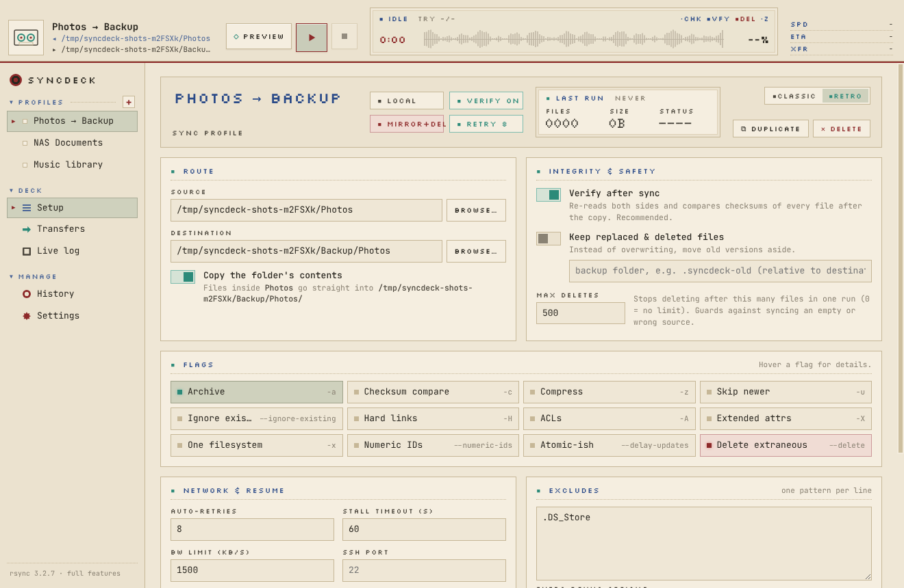

# SyncDeck

A local, retro-styled rsync cockpit for macOS. Pick a source and a destination,
flip the flags you want, preview exactly what will change, then sync with live
progress, automatic reconnects and a checksum verification at the end.



## Quick start (on your Mac)

```bash
brew install rsync node     # rsync 3.x gives you full progress, resume and safety features
cd syncdeck
npm install
npm start                   # run the app
npm run dist                # optional: build dist/SyncDeck-1.0.0-arm64.dmg
```

SyncDeck finds Homebrew's rsync on its own (`/opt/homebrew/bin/rsync`, then
`/usr/local/bin/rsync`, then `/usr/bin/rsync`). It also works with the
`openrsync` that ships with macOS, but tells you which safety features that
version is missing.

The app is not code-signed. If macOS refuses to open a built `.app`, right-click
it and choose **Open**, or run `xattr -cr /Applications/SyncDeck.app`.

## What it does

| | |
|---|---|
| **Profiles** | Saved sync jobs in the sidebar. Every edit autosaves. |
| **Route** | Source and destination with a folder picker, or `user@host:/path` for SSH. A switch makes rsync's trailing-slash rule explicit and shows where files will land. |
| **Flags** | Archive, checksum compare, compress, skip newer, ignore existing, hard links, ACLs, xattrs, one filesystem, numeric IDs, delayed updates, delete. Flags your rsync can't do are greyed out. |
| **Preview** | A dry run that lists every new, changed and deleted file before anything is touched. One click runs the real sync from there. |
| **Live deck** | Overall %, speed, ETA, current file, attempt counter, and a waveform that fills as data moves. |
| **Transfers** | Virtualised list of every itemised change, with filters and search. Handles very large trees. |
| **Live log** | Raw rsync output, including the exact command of every attempt. |
| **History** | Every run with status, size, duration, attempts and verify result. |

Shortcuts: `⌘⇧P` preview, `⌘R` run, `⌘.` stop, `⌘N` new profile.

## Data integrity and safety

* **Verify after sync** (on by default): after the copy, a second rsync pass in
  checksum dry-run mode reads both sides and lists anything whose content
  differs. Silent corruption that rsync's size+mtime quick check can't see is
  caught here (see `test/integration/local.test.js`).
* **Resume after network trouble:** `--partial-dir=.rsync-partial` keeps half
  copied files; `--timeout` turns a frozen link into an error instead of a hang;
  network-type exit codes (5, 10, 12, 30, 35, 255) are retried with exponential
  backoff (5 s, 10 s, 20 s … 5 min, ±20% jitter, 8 retries by default). Each
  retry resumes from the partial data. Permission errors and the like are not
  retried.
* **Delete guard rails:** delete is off by default, needs an explicit
  confirmation, is limited by `--max-delete` (500 by default), and is refused
  outright when the source folder is empty (an unmounted drive), when the
  destination is `/`, your home folder or a system folder, or when one folder
  is inside the other. An optional backup folder keeps every replaced or
  deleted file.
* **No shell, ever:** rsync is spawned with an argument array (`shell: false`).
  Paths come after a literal `--`, so names like `--delete` or
  `; rm -rf ~` are just names. `~` is expanded by the app, not a shell.
* **Extra options are filtered:** `-e/--rsh`, `--rsync-path`, `--delete-excluded`,
  `--log-file`, batch files and similar are refused; risky ones such as
  `--remove-source-files` or `--inplace` need confirmation.
* **SSH is locked down:** `BatchMode=yes` (keys only, no password prompts),
  normal host-key checking, keep-alives so dead links are noticed, and `-s` so
  remote paths aren't re-split by the remote shell. Plain `rsync://` daemon
  links are flagged as unencrypted.
* **Electron hardening:** sandboxed renderer with context isolation and no Node
  access, a strict Content-Security-Policy, no remote content, navigation and
  new windows blocked, file names always rendered as text. Settings are written
  atomically (temp file, fsync, rename) with `0600` permissions.
* The Mac is kept awake during a sync, and quitting mid-sync asks first.

## Tests

```bash
npm test             # unit + integration (needs rsync)
npm run test:e2e     # drives the real app with Playwright (Linux: xvfb-run -a npm run test:e2e)
npm run screenshots  # regenerates docs/screenshots
```

* **Unit** (`test/unit`, 54 tests): argument building, injection-proof paths,
  parsers for progress/itemize/stats in several rsync versions and locales,
  safety validation, retry policy, the run state machine with a scripted fake
  rsync (retry, give up, stop during backoff, verify mismatches, exit codes).
* **Integration** (`test/integration`, 17 tests, real rsync): byte-for-byte copies
  of hostile file names (unicode, quotes, `$(...)`, leading dashes, emoji),
  hostile folder names, dry-run touches nothing, mirror vs. copy, max-delete,
  backups, silent-corruption detection, excludes, stop-and-resume, unreadable
  files, and a simulated limited/old rsync.
* **Network drills** (`test/integration/network.test.js`): a real rsync daemon
  behind a TCP proxy that is cut mid-transfer, taken down for seconds, frozen
  silently, and flapped three times. Each run must recover by itself, resume
  from partial data (the final attempt re-sends well under the full size), and
  finish with a passing checksum verification.
* **End-to-end** (`test/e2e`, 4 tests): the real Electron app is driven through
  setup, preview, confirm, sync, verify, history, restart persistence,
  stop/resume, the empty-source delete block, and a network drop that shows
  LINK LOST and recovers.

A GitHub Actions workflow runs all of it on macOS (Homebrew rsync) and Linux.

## Layout

```
main.js              Electron main process: IPC, runs, history, menus
preload.js           the small API the UI is allowed to use
src/core/args.js     profile -> rsync argv (no shell)
src/core/safety.js   validation, delete guards, retry policy
src/core/runner.js   one sync job: attempts, retries, verify, events
src/core/parse.js    itemize / progress / stats parsers
src/core/probe.js    asks the installed rsync which options it supports
src/store.js         atomic JSON storage
src/renderer/        the UI (plain HTML/CSS/JS, bundled fonts)
```
