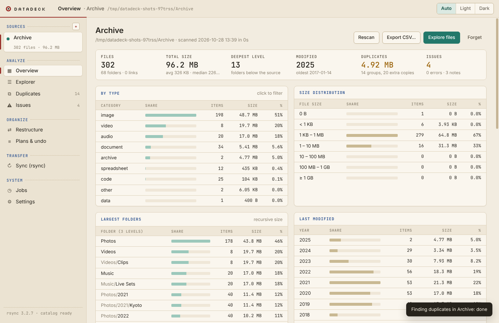
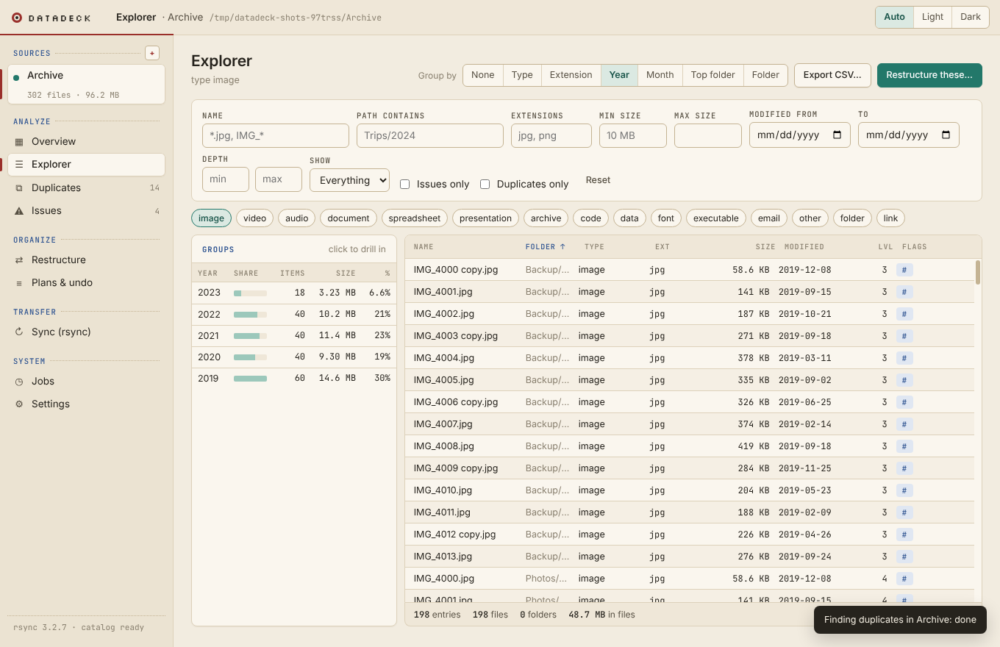
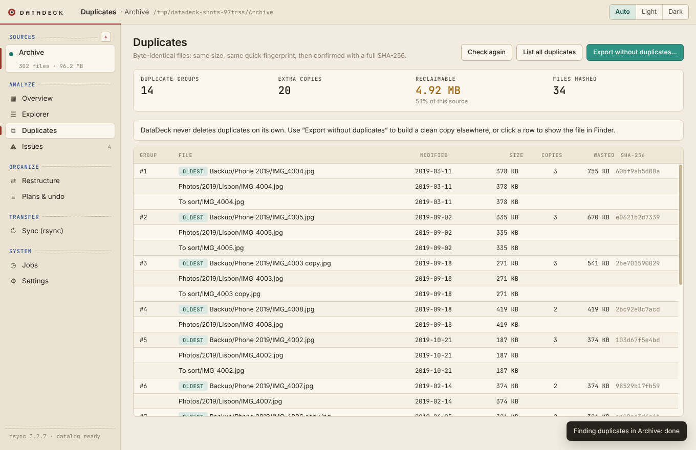
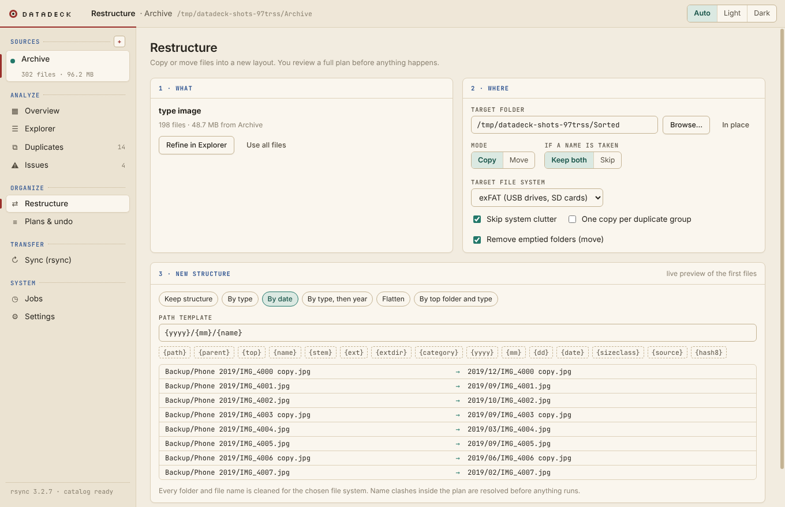
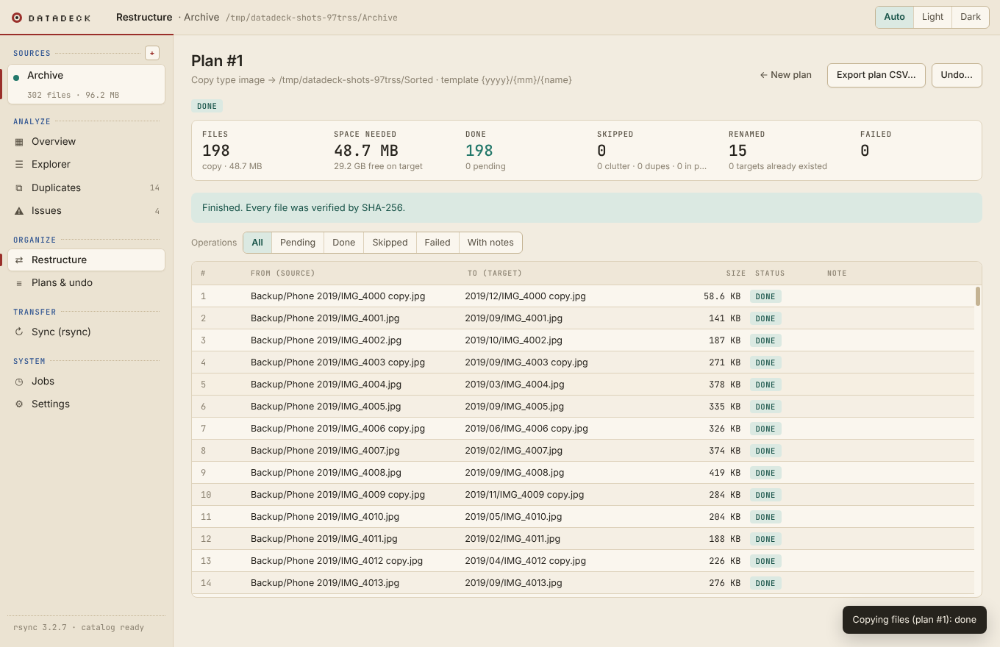
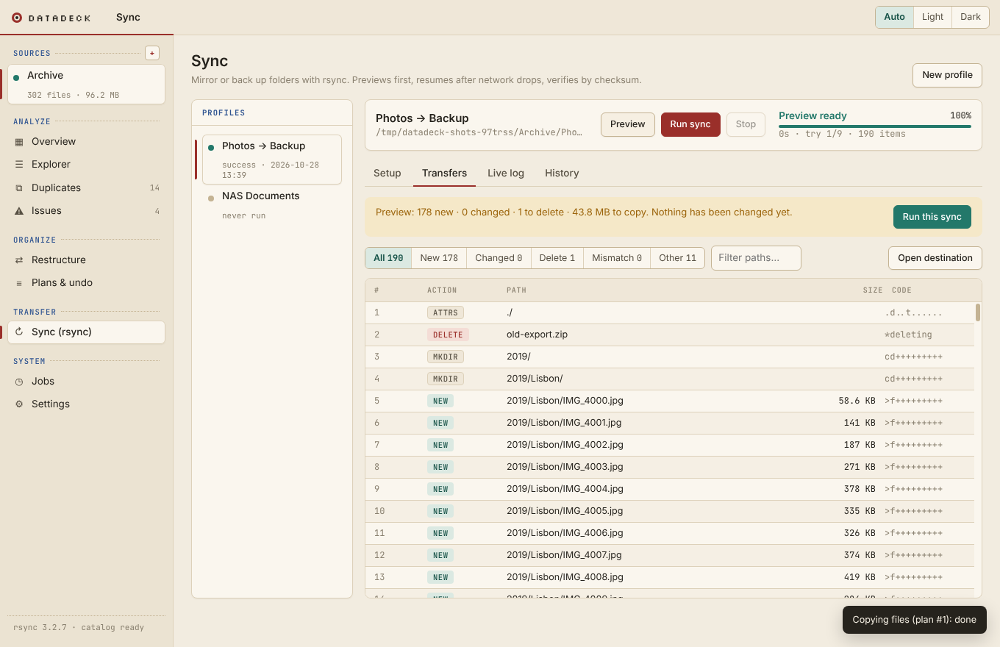
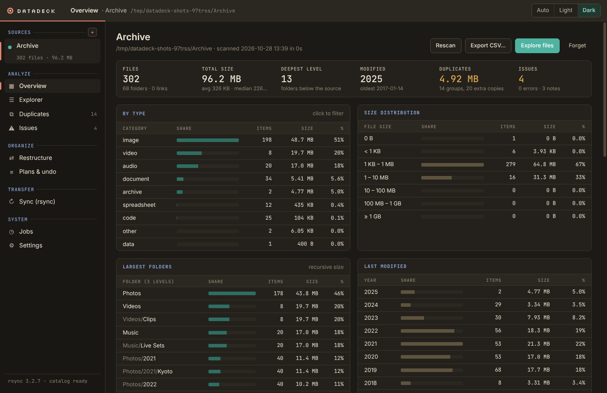

# DataDeck

A local data management cockpit for macOS. Point it at a folder of any depth,
see what is in it as statistics and sortable tables, find duplicates and names
that will break on other systems, filter down to exactly the files you mean,
then copy or move them into a new structure. Every change is planned first,
verified by SHA-256, journaled, and can be undone. Folder-to-folder or
folder-to-server sync with rsync is built in.



## Quick start (on your Mac)

```bash
brew install node rsync     # rsync 3.x is only needed for the Sync page
cd syncdeck
npm install
npm start                   # run the app
npm run dist                # optional: build dist/DataDeck-1.0.0-arm64.dmg
```

The app is not code-signed. If macOS refuses to open a built `.app`, right-click
it and choose **Open**, or run `xattr -cr /Applications/DataDeck.app`.

## Pages

| | |
|---|---|
| **Sources** | Any folder, any depth. Scanned into a local catalog (metadata only, never file contents). Symlinks are recorded but not followed; unreadable parts are listed instead of stopping the scan. |
| **Overview** | Files, size, depth, date range, duplicates and issues at a glance, plus tables by type, size class, year, extension, depth, largest folders and largest files. Every row opens the Explorer filtered to it. |
| **Explorer** | One virtual table for millions of entries. Filter by name pattern, path, extension, type, size, date, depth, issues or duplicates; group by type, extension, year, month, top folder or folder; sort any column; export the result as CSV. |
| **Duplicates** | Byte-identical files: size, then a quick fingerprint, then a full SHA-256. Shows reclaimable space per group. Never deletes anything; offers an export that keeps one copy each. |
| **Issues** | Case and Unicode collisions, names invalid on Windows/exFAT/FAT32, trailing dots, too-long names and paths, >4 GB files for FAT32, odd dates, empty files and folders, clutter, broken links, unreadable entries. |
| **Restructure** | Take the current selection, choose a target and a layout (presets or a template such as `{category}/{yyyy}/{mm}/{name}`), see a live preview, build a plan, review every single operation, run it, undo it. Names are cleaned for the target file system. |
| **Plans & undo** | Every plan with its per-file journal: what went where, both checksums, the result. Resume interrupted plans, export the journal, undo finished ones. |
| **Sync** | Saved rsync profiles: preview, mirror or copy, automatic reconnects after network drops, checksum verification afterwards, live log and history. |
| **Jobs / Settings** | Background work with progress and cancel; rsync path, notifications, keep-awake, light/dark/auto theme. |

Shortcuts: `⌘O` add source, `⌘N` new sync profile, `⌘⇧P` sync preview, `⌘R` run sync, `⌘.` stop.

| | |
|---|---|
|  |  |
|  |  |
|  |  |

## Data integrity and safety

**Restructuring**

* Nothing is touched until you run a plan you have reviewed.
* Each file is written under a temporary name, fsynced, **read back and
  compared by SHA-256**, and published with an operation that fails rather than
  replace an existing file. Existing files are never overwritten.
* A file that changed since the scan is skipped, not copied in a half-known state.
* Moves on the same disk are renames (no data copied). Moves across disks
  delete the original only after the verified copy exists.
* Every step is journaled in SQLite (WAL, full sync). After a crash or power
  cut the plan shows as interrupted; resuming cleans up and continues.
* Undo moves files back (verified) or deletes copies only if they are still
  exactly what was written. Files you edited afterwards are left alone.
* Emptied folders are removed with `rmdir` only: DataDeck never deletes a file
  that is not part of the plan.

**Sync (rsync)**

* Dry-run preview first; delete is off by default, needs confirmation, is capped
  by `--max-delete`, and is refused for an empty source (an unmounted drive),
  system folders, or nested source/destination.
* Resume after network trouble with `--partial-dir`, stall timeouts, and
  automatic retries with backoff on network exit codes.
* A checksum verify pass after the copy catches silent corruption.
* rsync is spawned without a shell, paths come after `--`, dangerous extra
  options are refused, SSH runs in batch mode with host-key checking.

**App**

* The heavy work runs in a worker thread, so the window stays responsive; one
  disk-heavy job at a time; the worker restarts itself after a crash.
* Sandboxed renderer with context isolation, no Node access, strict
  Content-Security-Policy, navigation blocked, file names always rendered as
  text, whitelisted engine calls with bound SQL parameters.

See [docs/ARCHITECTURE.md](docs/ARCHITECTURE.md) for the design and roadmap.

## Tests

```bash
npm test             # unit + engine + integration (103 tests; rsync needed for integration)
npm run test:e2e     # drives the real app with Playwright (Linux: xvfb-run -a npm run test:e2e)
npm run screenshots  # regenerates docs/screenshots
```

* **Unit** (54): rsync arguments, parsers, safety rules, retry state machine.
* **Engine** (32): scanning odd trees (300 levels deep, Unicode, symlink loops,
  unreadable folders, 20k files), issue rules, duplicates, CSV export, and every
  restructure guarantee with injected corruption, simulated crashes, changed
  sources, cross-device moves and undo.
* **Integration** (17): real rsync with hostile file names, delete limits,
  corruption detection, and network drills with a proxy that cuts, freezes and
  flaps the link.
* **End-to-end** (5): the real app, from adding a source through analysis,
  filtering, planning, a verified copy and undo; plus preview/mirror/verify,
  stop and resume, the empty-source guard and a network drop.

A GitHub Actions workflow runs all of it on macOS and Linux.

## Layout

```
main.js                 Electron main: window, IPC, menus, rsync runs
preload.js              the small API the UI is allowed to use
src/engine/             catalog + analysis + restructure (runs in a worker thread)
  db.js                 SQLite schema
  scanner.js            streaming folder scan
  analysis.js query.js  statistics, filters, grouping
  compat.js             file-system rules and name sanitising
  dupes.js hash.js      duplicate detection
  template.js planner.js executor.js   plans, verified execution, recovery, undo
  engine.js worker.js client.js        job control and the worker bridge
src/core/               rsync: arguments, safety, runner, parsers
src/renderer/           the UI (plain HTML/CSS/JS, bundled fonts)
test/                   unit, engine, integration, e2e
```
